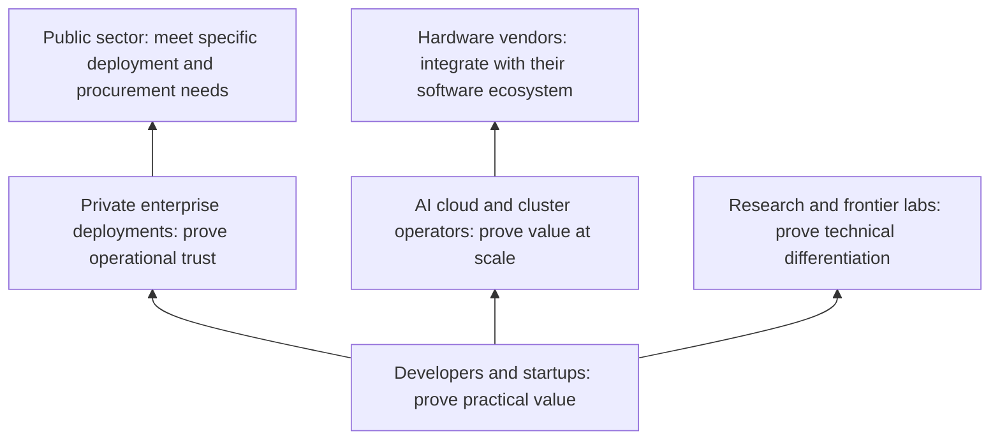

# Selfbyt three-year brand and company plan

Planning horizon: October 2026 to September 2029.

Developer release target: mid-November 2026, using 15 November as a working planning date. The founder has already spent years developing the underlying technology. This plan starts with turning that existing work into a usable developer release; it does not restart the research from zero.

Status: proposed strategy, based on founder direction. Milestones are planning targets, not forecasts or claims about existing capabilities. Review quarterly and adjust to customer evidence, team capacity, and available funding.

## Strategic judgment

Selfbyt’s aim is to make AI easier and less costly to deploy. Its current technical direction, as described by the founder, is reducing the compute needed to run models. Treat the magnitude, supported workloads, and quality tradeoffs as unverified until benchmarked.

Begin with developers and startups to establish practical value. In parallel, seek technical evaluation partners among AI infrastructure operators and labs if the measured advantage applies to their workloads. Enterprise deployment and large-scale efficiency are two possible commercialization paths; enterprise adoption is not a prerequisite for a lab or operator partnership.

Think of the triangle as increasing deployment responsibility and depth of integration. Developers form the broad discovery base. A smaller group of paying teams establishes repeatable use. Private enterprise deployments require greater operational trust. Strategic infrastructure partnerships sit above that foundation.

The upper markets are separate branches, rather than compulsory steps in one ladder:

A data center facility owner may have no need for model software; the actual buyer could be an AI cloud operator or the team operating a compute cluster. A chip manufacturer might be an integration partner rather than a conventional customer. Governments may need a private deployment through a local systems integrator. Frontier labs may only care about a narrow technical improvement that fits their existing stack.

Developer adoption does not automatically validate enterprise demand. Interview enterprise infrastructure and security teams during year one, while keeping the first product focused.

## Brand direction

Keep Selfbyt as the company name and retain the open-circle / filled-circle mark. Use a broad company identity with specific product descriptions underneath it.

Proposed company positioning:

> Selfbyt builds infrastructure that makes AI simpler to deploy and more affordable to run.

This is a direction to build toward. Public copy should state exactly what each released product currently supports.

Technical focus: reduce the resources needed for useful model inference. Lower compute, lower memory use, lower energy, and lower cost are distinct outcomes; measure each rather than assuming one implies the others. Easier deployment is the product experience that makes the technical improvement accessible.

Three themes connect the roadmap:

- Efficiency: measurable improvements in resource use or deployment effort, with quality and workload constraints disclosed.
- Control: clear choices about models, deployment location, data handling, and system operation.
- Evidence: reproducible experiments, documented limitations, and results from real use.

Retain “Intelligence. Built from the foundations.” as the brand headline. Give product pages a concrete description of what a developer can do today. For example, “Run supported models on your own infrastructure” is suitable only when that capability is actually available.

Do not lock the brand to sparsity, one representation, or a provisional product name. Avoid promising the fastest, cheapest, most private, or frontier-grade system without specific supporting evidence. Future models can remain part of the research direction without becoming a launch commitment.

Keep one visual identity across audiences: cobalt for emphasis, paper for clarity, ink for contrast, simple technical diagrams, and generous space. Enterprise confidence should come primarily from documentation, deployment evidence, and support rather than a separate corporate rebrand.

## Product coherence

Build one shared technical foundation. Add products where repeated customer needs justify them: a developer runtime or SDK, private deployment tooling, then operational or performance integrations. These are candidate forms, not a commitment to ship all of them.

The initial working hypothesis is that small teams need a simpler, more controllable way to run supported models within a constrained compute budget. Validate this against alternatives and against actual Selfbyt capabilities before selecting the first offer.

Each new product must answer four questions:

1. Who has the problem, and what do they use now?
2. What measurable improvement can Selfbyt deliver?
3. Which existing capability, integration, or customer relationship does it reuse?
4. Who will maintain and support it after launch?

Maintain a research track for new representations and model work. A small model built to test a systems hypothesis is a sensible experiment. A general frontier-model program requires a separate case for compute, data, evaluation, and sustained funding.

## Year one: prove usefulness

October 2026 to September 2027.

Primary audience: developers and small AI product teams with a concrete inference or deployment constraint. Choose one workload and a narrow supported model and hardware range.

### Developer release: October to mid-November 2026

The initial release should let an external developer install the system, run a supported model, and understand its benefit and limitations without the founder completing every step for them. A focused developer preview is appropriate if production reliability is not yet established.

| Window | Priority | Deliverable |
| --- | --- | --- |
| 6 to 18 October | Select the working path through the existing technology | One supported workload, explicit model and hardware requirements, a reproducible baseline, and a list of release blockers |
| 19 October to 1 November | Package the working capability | A versioned package or container, a quickstart, a runnable example, clear errors, and documented limitations |
| 2 to 8 November | Test outside the development environment | 3 to 5 external developers attempt installation and a real workload; fix failures that prevent successful use |
| 9 to 15 November | Stabilize and release | Tagged release, verified installation instructions, reproducible results, changelog, and an issue/support channel |

Keep research changes outside the release path unless they fix a blocker. Broader model coverage, enterprise features, and new products can follow the first usable release.

Release acceptance criteria:

- At least 3 external developers independently complete the quickstart on supported hardware.
- Installation, model acquisition, model licenses, and hardware requirements are documented.
- At least one useful workload runs end to end, with output quality checked against the chosen baseline.
- Any published efficiency claim has reproducible measurements and stated tradeoffs. Do not delay an honestly labeled preview solely to make a broad performance claim.
- Known failures, unsupported configurations, and experimental features are explicit.
- Developers can report issues, and releases have versions so results can be reproduced.

If the public-release criteria are not met by mid-November, release to a small invited group with the limitations stated and prioritize the blocking issues. Do not describe that as a production-ready general release.

### Mid-November to January: validate adoption

- Interview approximately 15 to 20 developers and startup teams, plus 5 enterprise infrastructure or security stakeholders.
- Recruit 3 to 5 design partners willing to supply realistic workloads and test releases.
- Include an inference infrastructure team or lab as an evaluation partner if the prototype supports its models and hardware. Do not wait until year three to learn whether the improvement survives its workload.
- Choose one initial problem and baseline it against the tools those teams actually use.
- Define a repeatable evaluation: hardware, model, task quality, latency, throughput, peak memory, and deployment steps. Select a primary metric rather than trying to win every dimension.
- Separate arithmetic reduction from measured runtime benefit. Record end-to-end latency, throughput at realistic concurrency, memory, and measured energy where possible. Include preprocessing, model conversion, and amortized preparation costs when applicable. Compare against an optimized baseline and report quality changes and unsupported cases.
- Use feedback from the November release to improve documentation, supported configurations, and the first successful user experience.

### Months 4 to 6

- Release one usable core capability with a documented support boundary.
- Observe installation failures, time to first successful run, weekly usage, and reasons people stop using it.
- Publish reproducible results with quality checks and failure cases. Include a strong maintained baseline on the same hardware and workload.
- Ask repeat users to pay for a defined benefit such as support or deployment tooling; use the response to test willingness to pay.

### Months 7 to 12

- Fix the reliability and integration issues that block repeated use.
- Produce 2 customer-approved case studies when evidence and permissions allow.
- Run an early private-deployment pilot using the same core technology.

Proposed exit gate: at least 5 independent teams use the product weekly for 8 consecutive weeks; at least 3 organizations pay for a repeatable offer; a meaningful improvement is reproduced on 2 realistic workloads without violating agreed quality constraints. These are starting targets, not universal product-market-fit criteria. GitHub stars and downloads alone do not satisfy the gate.

If teams do not return or will not pay, narrow or change the offer before expanding the customer list.

## Year two: prove operational trust

October 2027 to September 2028.

Primary audience: enterprises with a named deployment owner, a real private-AI use case, and budget. Begin with one deployment pattern, such as customer-managed cloud or on-premises infrastructure, rather than supporting every environment.

If year-one evidence is substantially stronger with an AI cloud operator or lab than with enterprise deployment buyers, prioritize that commercialization path instead. Keep the same focus on repeatability, support, and paying demand; do not force the calendar sequence.

### First half

- Turn the year-one private deployment into a repeatable installation and upgrade process.
- Map data flow, outbound network traffic, telemetry, logs, credentials, and third-party dependencies. State what “private” means for this deployment.
- Add access controls, useful audit records, monitoring, rollback, and documented incident handling appropriate to the actual product.
- Secure 2 to 3 paid pilots with acceptance criteria, a deployment owner, and a decision date.

### Second half

- Convert successful pilots into maintained production deployments.
- Establish a support offer that the team can realistically deliver. Promise service levels only after measuring operational capability.
- Pursue assurance or certification when required by qualified buyers and supported by resources. Customer-managed deployment and compliance certification are different things.
- Add a second product module only when several customers share the same need and it builds on the existing foundation.

Proposed exit gate: 3 to 5 paying production organizations; at least 2 renewals or expansions when contracts become eligible; repeatable installation and upgrades; measured reliability against agreed service objectives; and positive contribution after direct infrastructure and delivery/support costs. Confirm that founder-led custom work is not disguising an unrepeatable product.

If enterprise delivery consumes the team without repeatable revenue, simplify the deployment offer or work through a capable integration partner.

## Year three: prove value at scale

October 2028 to September 2029.

Select one primary expansion based on the strongest evidence from the first two years:

| Expansion | Reason to choose it | Required proof |
| --- | --- | --- |
| AI cloud or cluster operators | Selfbyt improves the economics or operation of a supported workload | Realistic concurrency, tail latency, reliability, utilization, and total deployment cost |
| Research or frontier labs | Selfbyt has a distinctive representation, execution, or evaluation capability | Reproducible results and integration into the lab’s actual workflow |
| Hardware vendors | A runtime or kernel makes a particular architecture more useful | Validated performance, supported interfaces, and an integration owner |
| Public sector through a partner | A specific private deployment matches a funded use case | Clear deployment responsibilities, procurement fit, support, and applicable local requirements |

### First half

- Recruit one serious partner in the chosen branch.
- Run a jointly defined technical evaluation with success criteria, resource commitments, and a commercial decision date.
- Keep developer releases and enterprise deployments healthy while evaluating the larger opportunity.
- Expand the supported hardware or workload only when customer demand and test coverage justify it.

### Second half

- Aim for one paid production deployment or commercial integration in the selected branch.
- Publish a validated scale result where permitted, including quality and operational tradeoffs.
- Decide whether the next phase should deepen the runtime, broaden private deployment, license technology, or fund a focused model program.

Proposed exit gate: one paid strategic deployment or integration, evidence of value on realistic workloads at the relevant scale, and a second qualified organization with the same need. An exploratory meeting or memorandum alone does not establish repeatability.

Reaching every upper market or becoming a frontier lab within three years is not the target. Establishing a useful infrastructure business with one credible route to larger-scale adoption is.

## Operating discipline

As an initial planning guide, devote roughly 70% of engineering capacity to the core product and reliability, 20% to customer integration and tooling, and 10% to exploratory research. Revisit this quarterly; it is not a hiring or spending forecast.

Fund each phase against a concrete next milestone. Track burn, runway, customer concentration, direct support effort, and infrastructure costs internally. Decide how many pilots the team can support before agreeing to more. Exact staffing, revenue targets, and budgets require current team size, funding, and technical maturity.

Review quarterly:

- Adoption: active teams, successful activation, repeated usage, and abandonment reasons.
- Technical value: primary workload metric, quality constraints, reproducibility, and regressions.
- Commercial value: paying organizations, renewals, expansion, and contribution after direct costs.
- Delivery: installation effort, upgrade failures, support load, and incidents.
- Focus: whether new requests reuse the foundation or pull the company into unrelated work.

## First 90 days

The immediate priority is a usable developer release by mid-November 2026, built from the technology already developed. The remainder of the first 90 days should establish a baseline benchmark, 3 to 5 design partners, and evidence that developers return to use the product. Build relationships with future enterprise and infrastructure buyers now, while keeping product delivery focused on the initial audience. Publish useful technical notes and honest results under one Selfbyt identity.

## Evidence informing this recommendation

These examples show existing deployment patterns and competitive expectations. They do not establish demand for Selfbyt or predict its success.

- [NVIDIA NIM](https://www.nvidia.com/en-us/ai-data-science/products/nim-microservices/) offers packaged inference across cloud, data center, workstation, and edge environments. Deployment packaging alone is therefore insufficient differentiation.
- [Hugging Face private endpoint security](https://huggingface.co/docs/inference-endpoints/security) distinguishes authenticated public access from private network access. Privacy should be described through actual architecture rather than a broad label.
- [Hugging Face enterprise endpoint access](https://huggingface.co/docs/inference-endpoints/guides/access) describes enterprise support and service guarantees. This illustrates the operational expectations that accompany enterprise deployment.
- [MLPerf Inference Datacenter](https://mlcommons.org/benchmarks/inference-datacenter/) evaluates inference performance under defined quality and latency conditions, with a separate measured-power methodology. This informs the benchmark discipline; it does not validate Selfbyt’s implementation or require a formal submission at this stage.

Sources checked 6 October 2026. The market sequence, gates, and product choices above are strategic recommendations, not findings established by these sources.
